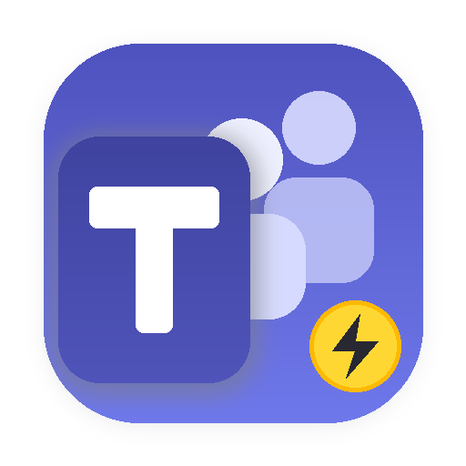

<div align="center">



# ⚡ MICROSOFT TEAMS LITE (RUST) ⚡

### *Khắc tinh của ngốn RAM — Bản Client Teams Native Siêu Nhẹ Dành Cho Windows*

[](https://www.rust-lang.org/)
[](https://slint.dev/)
[](https://microsoft.com)
[](https://github.com/thichcode/teams-rust-lite)
[](SECURITY.md)
[](https://github.com/thichcode/teams-rust-lite/actions)
[](LICENSE)

<br/>

> **"Tạm biệt nỗi ám ảnh Electron ngốn 1GB RAM mỗi khi mở máy làm việc."**  
> **Teams Rust Lite** được xây dựng từ con số 0 bằng **Rust 🦀** và **Slint UI 🎨**, mang lại trải nghiệm chat công việc tức thì, mượt mà ở 60+ FPS với mức tiêu thụ tài nguyên chỉ bằng **1/15** bản Teams chính thức!

---

</div>

## 📊 Bảng So Kèo: Teams Lite vs Teams Official

| Tiêu chí | 🐢 Teams Chính Thức (Electron/WebView2) | 🚀 Teams Rust Lite (Native) |
| :--- | :---: | :---: |
| **Mức RAM tiêu thụ** | **~800 MB - 1.5 GB+** | **< 60 MB** 🟢 *(Giảm ~95%)* |
| **Tốc độ khởi động** | ~4 - 10 giây (nặng nề) | **< 0.4 giây** ⚡ *(Bật là lên ngay)* |
| **Engine dựng hình** | Chromium / Blink Engine | **Slint (Direct3D / Vulkan / GPU Native)** |
| **Độ trễ tin nhắn** | Polling API / Delay | **WebSocket Trouter (Real-time Push tức thì)** |
| **Dung lượng cài đặt** | ~350 MB - 600 MB | **~25 MB (File thực thi duy nhất)** |
| **Chạy ngầm Taskbar** | Ngốn ngầm RAM & CPU | **System Tray siêu tiết kiệm năng lượng** |

---

## ✨ Tính Năng Nổi Bật (Features)

* 🎨 **Giao Diện Native Siêu Đẹp (GPU-Accelerated):**
  * Thiết kế theo phong cách Fluent / Modern Teams tinh tế.
  * Phân biệt rõ rệt tin nhắn đi/đến, hiển thị avatar ký tự, đếm tin chưa đọc và lọc cuộc trò chuyện.
  * Tự động làm sạch mã HTML thừa từ RichText của Teams thành văn bản thanh thoát, dễ đọc.

* 🔐 **Đăng Nhập Chuẩn Doanh Nghiệp (OAuth2 Device Code Flow):**
  * Hỗ trợ tài khoản trường học & doanh nghiệp (FPT, Office 365, v.v.).
  * Hỗ trợ đầy đủ **MFA (2FA)**, **SSO**, xác thực bảo mật đa lớp của Microsoft.
  * **Tự động sao chép mã xác thực vào Clipboard** và mở trình duyệt — trải nghiệm đăng nhập 1-click không lỗi redirect!
  * Token được lưu trữ bảo mật bằng mã hóa cấp hệ điều hành qua **Windows Credential Manager (Keyring)**.

* 📡 **Giao Thức Trực Tiếp & Real-time Push (Zero-Polling):**
  * Giao tiếp trực tiếp với hạ tầng `chatsvcagg.teams.microsoft.com` để tải lịch sử và gửi tin nhắn.
  * Kết nối WebSocket thời gian thực tới gateway **Trouter** (`go.trouter.teams.microsoft.com`), lắng nghe tin nhắn mới không độ trễ.

* 🔔 **Tích Hợp Sâu Vào Windows OS:**
  * **Native Windows Toast Notifications:** Bắn thông báo nổi góc màn hình khi có người gửi tin nhắn mới.
  * **System Tray:** Thu nhỏ ứng dụng xuống khay hệ thống cạnh đồng hồ, click đúp để mở lại ngay lập tức.

* 🔄 **Tự Động Cập Nhật (Smart Updater):**
  * Tích hợp nút kiểm tra phiên bản mới (`⇪`) trực tiếp từ GitHub Releases.
  * Nhận thông báo và tải bản cập nhật mới nhất chỉ với 1 cú click.

---

## 🛡️ Đánh Giá Bảo Mật Doanh Nghiệp (Security & Enterprise Safe)

Ứng dụng được thiết kế tuân thủ nghiêm ngặt các tiêu chuẩn an toàn thông tin khi dùng trong môi trường công ty:

* 🟢 **Không Máy Chủ Trung Gian:** 100% kết nối đi thẳng tới các domain chính thức của Microsoft (`login.microsoftonline.com`, `teams.microsoft.com`, `trouter.teams.microsoft.com`).
* 🟢 **Không Thu Thập Dữ Liệu (Zero Telemetry):** Tuyệt đối không lưu log nội dung chat hay theo dõi hành vi người dùng.
* 🟢 **Mã Hóa Cấp Hệ Điều Hành:** Token đăng nhập được lưu trữ an toàn trong **Windows Credential Manager** thông qua chuẩn mã hóa **Windows DPAPI**.
* 🟢 **Minh Bạch Quyền Hạn (Least Privilege):** Sử dụng chuẩn **Device Code Flow** với Client ID chính thức của Microsoft Teams, chỉ yêu cầu quyền gửi nhận tin nhắn cơ bản, không đòi hỏi quyền Admin của công ty.

👉 *Xem báo cáo kiểm toán bảo mật chi tiết tại:* **[SECURITY.md](SECURITY.md)**

---

## 🏗️ Kiến Trúc Hệ Thống (Architecture)

```text
┌────────────────────────────────────────────────────────┐
│                   SLINT GUI THREAD                     │
│  (Window, Chat List, Message View, Composer, Tray)     │
└───────────────────────────▲────────────────────────────┘
                            │  tokio::sync::mpsc
                            ▼
┌────────────────────────────────────────────────────────┐
│               TOKIO ASYNC CORE RUNTIME                 │
│                                                        │
│  ┌──────────────────┐  ┌─────────────────────────────┐ │
│  │   OAuth Manager  │  │      Teams Chat Client      │ │
│  │  (Device Code)   │  │   (REST chatsvc Protocol)   │ │
│  └──────────────────┘  └─────────────────────────────┘ │
│                                                        │
│  ┌──────────────────┐  ┌─────────────────────────────┐ │
│  │   Token Store    │  │       Trouter Engine        │ │
│  │ (Windows Keyring)│  │    (WebSocket Push/Heart)   │ │
│  └──────────────────┘  └─────────────────────────────┘ │
└────────────────────────────────────────────────────────┘
```

---

## 🚀 Hướng Dẫn Cài Đặt & Chạy

### Cách 1: Tải Bản Đã Build Sẵn (.exe)
Truy cập mục [Releases](https://github.com/thichcode/teams-rust-lite/releases) hoặc tải file artifact từ [GitHub Actions](https://github.com/thichcode/teams-rust-lite/actions).  
Chỉ cần tải về file `teams-rust-lite.exe` và chạy trực tiếp, **không cần cài đặt!**

### Cách 2: Tự Biên Dịch Từ Mã Nguồn (Build from source)
Yêu cầu: Máy đã cài đặt [Rust & Cargo](https://rustup.rs/) (phiên bản 1.75+).

```bash
# 1. Clone repository
git clone https://github.com/thichcode/teams-rust-lite.git
cd teams-rust-lite

# 2. Chạy ứng dụng trực tiếp ở chế độ phát triển
cargo run

# 3. Hoặc biên dịch bản Release tối ưu siêu nhẹ
cargo build --release
```
*File thực thi sau khi build nằm tại:* `target/release/teams-rust-lite.exe`.

---

## 💻 Trải Nghiệm Đăng Nhập (Login Flow)

1. Mở app và bấm **"Sign in with Microsoft"**.
2. App sẽ lấy mã xác thực từ Microsoft (ví dụ `IHBELLXCX`) và **tự động copy vào Clipboard** của bạn.
3. Trình duyệt tự động mở trang `https://login.microsoft.com/device`.
4. Nhấn **Ctrl + V** để dán mã vào trình duyệt và xác nhận đăng nhập.
5. Quay lại app — App sẽ tự động tải danh sách tin nhắn và kết nối WebSocket tức thì!

---

## 🛠️ Công Nghệ Sử Dụng (Tech Stack)

* **Ngôn ngữ:** Rust 2021 Edition
* **Async Runtime:** Tokio (Full multi-threaded)
* **Giao diện người dùng:** Slint UI 1.9 (GPU accelerated, Qt/Skia/FemtoVG backend)
* **Mạng & WebSocket:** Reqwest, Tokio-Tungstenite, Futures-util
* **Bảo mật:** Windows Credential Manager (`keyring`), OAuth2 Device Code Flow
* **Tích hợp Windows:** `tray-icon`, `notify-rust` (WinRT Toast)
* **Phân tích dữ liệu:** Serde, Serde_json, HTML2Text

---

## 🤝 Đóng Góp & Phát Triển (Contributing)

Mọi đóng góp, báo lỗi (Issues) hoặc Pull Requests đều được chào đón nồng nhiệt!
1. Fork dự án
2. Tạo nhánh tính năng (`git checkout -b feature/tinh-nang-moi`)
3. Commit thay đổi (`git commit -m 'feat: them tinh nang moi'`)
4. Push lên nhánh của bạn (`git push origin feature/tinh-nang-moi`)
5. Tạo Pull Request

---

<div align="center">

**Được xây dựng với tình yêu dành cho Rust 🦀 và hiệu năng tối thượng 🚀**  
*Tác giả: [thichcode](https://github.com/thichcode)*

</div>
